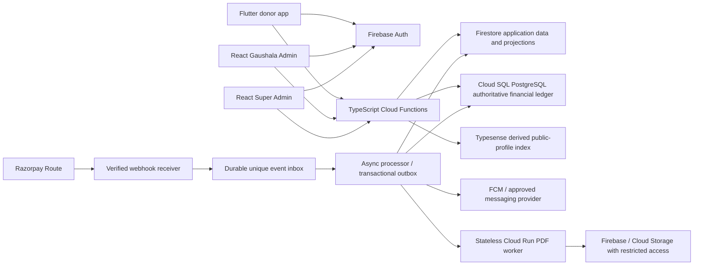

# System Architecture

**Status:** Proposed baseline for review. No service is provisioned and no application code is implemented. V2.1 corrects V2.0 where they conflict.

## Logical View

This diagram is a target proposal from the documents, not a verified deployment topology. Exact queue, transaction boundaries, service identities, networking, retry policy, and provider API calls require ADRs.

## Responsibilities and Trust Boundaries
- **Flutter / React clients:** display data and submit intents. Treat every input and client callback as untrusted; never hold privileged secrets or decide financial status.
- **Firebase Auth:** identity provider. Claims and memberships are server-managed; backend resolves tenant/object permissions on every sensitive request.
- **Cloud Functions:** trusted API and orchestration boundary. Validate auth, authorization, schema, current Gaushala eligibility/status, idempotency, and provider responses. Admin SDK access bypasses Firestore rules and requires explicit server authorization/IAM.
- **Firestore:** application records and read projections, including public profiles and donor-visible status. It is not the financial source of truth and does not provide arbitrary SQL unique constraints.
- **Cloud SQL PostgreSQL:** V2.1's authoritative financial ledger and durable event/idempotency storage proposal. It must reconcile to Razorpay events, transfers, and settlements. An event table alone is not a balanced double-entry ledger.
- **Razorpay Route:** external payment/linked-account/transfer provider. Exact charity marketplace eligibility, APIs, states, holds, refunds, settlement, and recurring behavior require written account-specific approval.
- **Typesense:** derived index of approved public Gaushala profile fields only. Firestore is source; sync handles retries, out-of-order events, deletions/suspension and reconciliation. Search must re-check current status before enabling donation.
- **Cloud Run:** stateless PDF rendering and other stateless worker tasks. Do not use ordinary ephemeral containers as persistent Typesense nodes or rely on local disk for durable state.
- **Firebase/Cloud Storage:** user uploads, public media, and restricted generated documents. Object access, retention, signed-link lifetime, and deletion policy must be separately defined.

## Environment Boundaries
Maintain isolated development, staging, and production cloud projects, provider modes, credentials, data, service identities, budgets, and approvals. Use emulators and synthetic data locally. Staging uses provider test mode. Production access is restricted and changes pass controlled CI/review. Exact project names, regions, IAM and state backend remain undecided.

## Reliability and Operations Baseline
Use durable asynchronous processing for webhooks and PDF work; transactional outbox/inbox design, idempotent retries, dead-letter recovery, reconciliation, SLOs, alerting, backups, restore exercises, and incident runbooks need detailed design. V2.1 rejects self-awarded readiness scores and requires evidence states. Treat V2.0 cost, scaling, and SLO values as estimates until recalculated and tested.

## Deferred / Not Approved
No microservice migration trigger, search topology, region, minimum instances, data residency claim, traffic target, RTO/RPO, or infrastructure plan is approved by this document. See [`../implementation/technical-decisions.md`](../implementation/technical-decisions.md).
